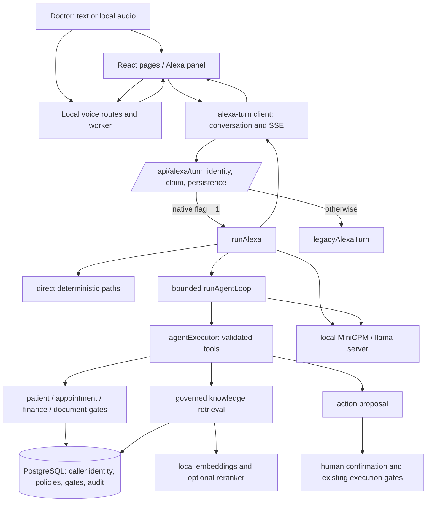

# Current architecture

**Status: PARTIAL, source reconstruction.** The checkout is `C:\MindCare\alexa-v8-final`, HEAD `b4bd811`, with pre-existing uncommitted changes including desktop/runtime files. Both `dist/doctor-next/win-unpacked` and `C:\Program Files\MindCare OS` exist and have different archive sizes and declared source fingerprints; see `25_PROVENANCE_DESKTOP.md`. Their manifests were sampled, but provenance has not been independently authenticated and the running process, configuration and database were not verified. The older path named as canonical in AGENTS.md was absent. Do not equate this source tree with the installed application.

The diagram denotes relationships found in source, not a runtime trace of every arrow. Legacy flow, complete action execution and every database policy still require inspection.

## Layer map

| Layer | Current source and contract | State / limitation |
|---|---|---|
| Input and UI | `src/components/AppShell.tsx`, `PanneauJarvis.tsx`, `src/app/jarvis/page.tsx`, `src/services/alexa-turn.ts` | Present in source. Screen inventory in `13_CARTOGRAPHIE_APPLICATION.md` and mechanical page index `18_INDEX_ECRANS_CODE.md`; rendered behavior NOT VERIFIED. |
| STT | `jarvis-voice-in/route.ts`, `src/server/voice/runtime.ts`, `modeles.ts` | Authenticated local 16 kHz PCM route and pinned faster-whisper model. Physical device, language accuracy and latency NOT RUN. |
| Conversation/session | `alexa-turn.ts`, `conversation-state.ts`, `agent-continuation.ts`, `turn/route.ts` | Structured context, expiry, revision and server persistence; conversation semantics beyond recognized cases NOT VERIFIED. |
| Intent and planning | `src/shared/alexa/request-plan.ts`, `request-contract.ts`, `orchestrator.ts`, `agent-loop.ts`, `src/shared/alexa/agent.ts` | Rule-based and local-model paths coexist; bounded decomposition and tool calls. Exact installed path and general accuracy NOT VERIFIED. See `04_ROUTING_AND_CONVERSATION_AUDIT.md`. |
| Model/provider | `model-policy.ts`, `local-model.ts`, `model-gateway.ts`, `src/server/egress/external-call.ts` | Local MiniCPM in examined native paths, older cloud qualification/provider code retained. Model selection by full task class and deployed config still to verify. See `07_MODEL_AND_PROVIDER_AUDIT.md`. |
| App tools | `src/shared/alexa/agent.ts`, `agent-tools.ts`, `application-reads.ts` | Strict schemas and authenticated execution across several domains; coverage and permissions must be checked per tool. See `05_APPLICATION_INTELLIGENCE_AUDIT.md`. |
| Knowledge | `src/server/knowledge/`, `knowledge-query.ts`, `knowledge-adapter.ts`, `knowledge-synthesis.ts` | Governed lexical and opt-in vector/rerank with sourced output; real source status, effective flags and retrieval quality NOT VERIFIED. See `06_RAG_FORENSIC_AUDIT.md`. |
| Patient context | `patient-resolver.ts`, `clinical-context.ts`, `clinical-coverage.ts`, `case-summary.ts` | Scoped revalidation, pagination, version and completeness markers; no proof that all patient information fits the DTO. See `17_PATIENT_CONTEXTE_ET_RESUME.md`. |
| Validation and authority | Zod contracts, patient revalidation, source/evidence checks, SQL gates, `withCaller`, action proposal/confirmation | Specific code paths inspected; all roles, policies, injection cases and write transitions NOT VERIFIED. See `08_SECURITY_AND_CLINICAL_INTEGRITY_AUDIT.md`. |
| Output and TTS | SSE in `turn/route.ts`; `alexa-turn.ts` validates and buffers batches; local Kokoro in `jarvis-voice-out/route.ts` | SSE does not itself prove progressive user-visible output. Arabic segments rejected on that TTS route. Physical audio NOT RUN. |
| Desktop and database | Electron main, local backend, PostgreSQL port: `electron/main/serveur-cabinet.ts`, `orchestrateur.ts`, `src/server/db/withCaller.ts`, `pgPort.ts` | Current source contains a local clinic-server/proxy startup architecture; versions, installed role, service/task, PostgreSQL instance and effective config NOT VERIFIED. |

## Source versus deployed configuration

`scripts/preparer-paquet.mjs` supplies `ALEXA_NATIVE_AGENT_ENABLED=1` to a build subprocess. In the current modified worktree, `electron/main/serveur-cabinet.ts`, `lireVariablesServeur`, supplies e5-base vector defaults for a packaged server and overlays explicit private configuration. These source statements do not prove the build includes them or that its runtime assets, database vectors and flags match. Avoid reading or copying protected environment values during verification; report only sanitized capability/status evidence when authorized.

## Limits and dependencies

The clinical source contract and applied database migrations govern behavior, not an architecture document. Patient reads and write permissions must remain database-enforced; model output is not a source of truth. An identified synthetic environment, approved knowledge material and physical devices are needed to complete the full correctness, retrieval and voice investigations. Current evidence and test status are in the focused audit files, not a production acceptance.
