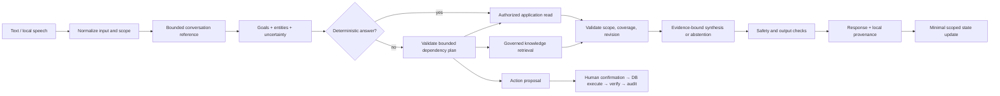

# Target Alexa architecture — review draft

**Status: PROPOSED / NOT APPROVED / NOT IMPLEMENTATION AUTHORIZATION.** This is a design hypothesis based on the partial audit. Final choices and implementation must wait for completion of the investigation, the baseline and the user's review. Existing database invariants and local-first privacy rules are non-negotiable. Do not add schema, migrations, providers or services on the strength of this draft alone.

## Architectural decision under review

Three approaches were considered:

1. Extend the existing bounded modular-monolith paths and audited database gates; add contracts only where actual gaps exist. **Recommended**: reuses security, source provenance and desktop deployment, with lower operational complexity. It requires careful consolidation of overlapping native/legacy routes and explicit qualification of each capability.
2. Replace routing and retrieval with a single powerful model that directly chooses data and speaks. Rejected: no deterministic permission boundary, unclear coverage and unproven privacy/clinical reliability.
3. Split the application into many independent agents or network services. Rejected as a default: extra failure states, privacy surfaces and deployment complexity are not justified by the evidence. Separate processes only when isolation or hardware measurement demonstrates a need.

## Proposed logical components

These are responsibilities, not a requirement to create 16 classes or services. Reuse existing modules before introducing new ones. Every data access runs under the authenticated actor; no model output is an authority grant.

| Component | Input → output | Reuse / dependency and access | Failure and verification |
|---|---|---|---|
| Conversation engine | user turn + actor-bound session → scoped turn envelope | `turn/route.ts`, `conversation-state.ts`, existing persistence | stale/expired/change of actor or patient → clear or clarify; test isolation and restart |
| Intent understanding | utterance + permitted prior state → candidate goals, entities, uncertainty | deterministic admission and bounded local planner | malformed/ambiguous → ask; test FR/AR/Darija and exact constraints |
| Context assembly | goal + actor + selected scope → minimal, versioned authorized context | patient resolver, `clinical-context.ts`, audited SQL gates | denied/stale/incomplete distinguished; no free note export; test coverage and authorization |
| Task planner | goals + capability descriptors → bounded acyclic steps/dependencies | existing ledger/agent types; no data access itself | validate schemas and grounding, reject excess/cycles; test multi-part/dependent requests |
| Workflow orchestrator | validated plan + deadline → typed part results | `runAgentLoop`, existing execution/continuation | cap calls, time, parallelism and retries; preserve partial statuses; test cancellation/replay |
| Application intelligence | capability ID + validated args + actor → structured result, scope, data revision and coverage | existing app services and authorized SQL gates | unavailable ≠ zero; permit only implemented semantic definitions; synthetic SQL oracle tests |
| Knowledge retrieval | query + approved-source scope → ranked, governed passages and provenance | existing query planning, lexical/vector gates, fusion and reranking | report missing asset/index and low evidence; evaluate per-language recall and faithful attribution |
| Memory manager | authenticated state + bounded references → relevant prior structured facts | existing conversation state and persistence | expire/reset on scope change; never persist raw clinical text solely for convenience; cross-patient tests |
| Model router | task, input classification, policy, budget → approved model or deterministic path | existing local model gateway; potential future provider interface | default local/abstain; policy evaluated before provider; test fail-closed and unavailable provider |
| Tool router | proposed capability + typed args + authenticated scope → allowed execution or rejection | existing registry/schemas and `agentExecutor` | explicit permission and constraint echo, no silent broadening; test least privilege and unknown tools |
| Reasoning | authorized local context + evidence → draft interpretation or structured selection | local qualified model, not database access | uncertainty and observed-vs-inferred distinctions; prompt injection and unsupported-claim tests |
| Answer generation | typed tool results + validated interpretation + evidence → natural response and sources | answer presentation and i18n | cite internally, avoid unsupported completion; clinician evaluates faithfulness and French |
| Critic / verification | proposed claims + originating data → allow, partial, reject | deterministic validation first, optional model only as supplementary signal | cannot certify itself; negative tests for numbers, negation, dates, source and patient identity |
| Safety / policy | actor, classification, requested capability, confirmation status → deterministic allow/deny | SQL/RLS, egress classification, confirmation gates | fail closed; never delegated to model; negative tests for role, injection, external egress and writes |
| Execution monitor | action ID + state → confirmed, executed-and-verified, failed or unknown | `jarvis-execution.ts`, persisted action outcome | fix transport uncertainty described in 22; never automatically replay uncertain write |
| Observability / evaluation | redacted stage events and version metadata → local diagnostic and measured gates | existing traces and `tests/eval/` | no patient content in logs; missing telemetry ≠ successful operation; test redaction and failures |

## End-to-end contract

Independent read-only steps may run in parallel only if they share a validated actor, compatible data revision and deadline. Dependent steps wait for their prerequisite. Failed branches remain visible as partial; a factual application answer must not be filled from model memory. The flow permits a deterministic result without an LLM. No uncontrolled recursive tool calling is proposed.

## Capability registry contract

Build from the **implemented** `agentSchemas`, executor and underlying gates, rather than a model-generated list. Proposed fields: stable `id`, domain and human description, versioned input/output schemas, read/propose-write classification, actor and resource scope, data sources/gate, completeness and revision semantics, timeout/cancellation, auditable event, required confirmation and human-visible supported/unsupported states. A registry entry is admitted only after matching the actual executor, SQL permission, tests and product meaning. A declaration or code file alone is insufficient. Version/availability checks must report unavailable features honestly.

## RAG proposal

Question normalization and entity/source constraints → optional bilingual expansion selected by measured benefit → lexical and compatible local vector search → rank fusion when both branches are usable → source/approval/edition and provenance filtering → optional qualified rerank → bounded context preserving negation, table qualifiers and adjacent meaning → evidence-linked generation/verification → French answer when requested, with inspectable provenance. Any stage may be skipped or fail safely; no unsupported translation or source name should be invented. Benchmark current lexical, E5 and mMARCO recipes before activation or replacement.

## Response contract

Return structured part status, factual result with actor/period/population, coverage/unknowns, distinct interpretation if requested, source references and safe display text. Clinical facts, historical facts and interpretation are separately typed. A valid no-data result differs from not stored, not supported, unavailable and unauthorized; avoid revealing prohibited existence. Use natural, concise French in a French conversation and retain medical meaning across languages. Never claim an action was performed until its outcome and effect are verified.

## Decisions and gates before implementation

- Human ratification of business definitions, response language, capability priorities and acceptance thresholds; choose an authoritative source/build for deployment.
- Explicit security, legal and clinical review before any external provider processes patient-derived information; no such permission is assumed. Claude Opus 5.5 may receive the code/handoff and synthetic examples only within the approved workspace and provider policy.
- Isolated synthetic database and approved knowledge evaluation, recorded baseline, per-role and concurrency tests, and physical voice tests.
- Any new table/column/enum or changes to applied migrations require the repository's explicit decision process; do not alter existing migrations, `STATE.md`, archives or clinical production data.
