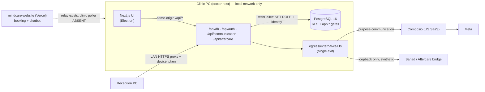
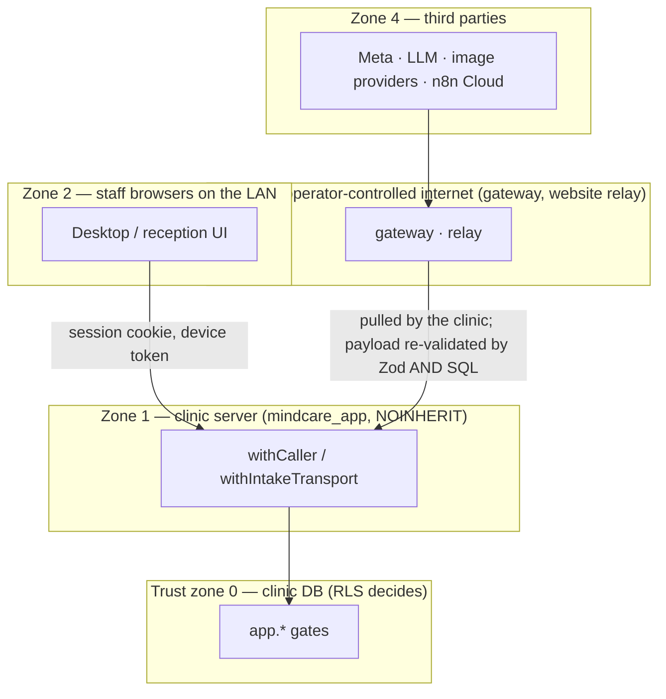
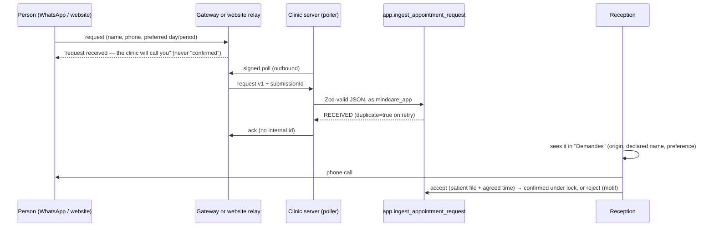
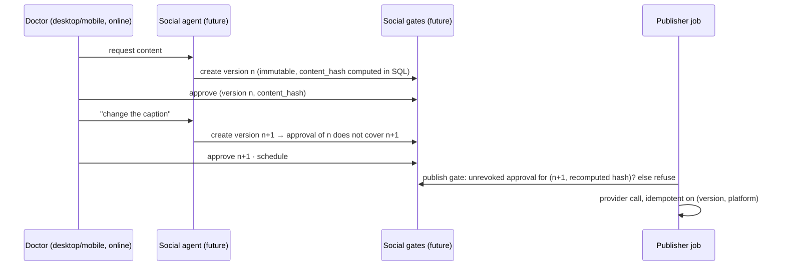
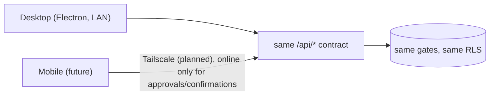

# MindCare integrations — architecture, status, roadmap

> Written 2026-11-26 from the repository as it is, not from older plans. Authority order is
> unchanged (`docs/DOC-AUTHORITY.md`): applied migrations > `CLAUDE.md` > ADRs > these documents.
> The archived "Engineering Constitution" (`docs/archive/`) is forbidden to agents and was
> **not** read; its binding rules are carried by `CLAUDE.md` §1, ADR-034 and
> `docs/02-SECURITY-BOUNDARY.md`.

## Where each requested deliverable lives

| Deliverable | Section |
|---|---|
| Integration architecture · current vs target | this file §2–§3 |
| Integration registry specification | [CONTRACTS.md §7](CONTRACTS.md#7-integration-registry) |
| API contracts · events · notifications | [CONTRACTS.md](CONTRACTS.md) |
| Webhook security specification | [WEBHOOK-SECURITY.md](WEBHOOK-SECURITY.md) |
| Appointment request workflow | [APPOINTMENT-REQUESTS.md](APPOINTMENT-REQUESTS.md) |
| Social content lifecycle · approval and publishing security · brand library | [SOCIAL-CONTENT.md](SOCIAL-CONTENT.md) |
| n8n integration guide · Meta integration readiness | [N8N-META-READINESS.md](N8N-META-READINESS.md) |
| Data residency and privacy assessment · threat model · provider comparison | [PRIVACY-DATA-RESIDENCY.md](PRIVACY-DATA-RESIDENCY.md) |
| Aftercare contract · desktop/mobile contract · website contract | [AFTERCARE-AND-CLIENTS.md](AFTERCARE-AND-CLIENTS.md) |
| Environment variables · deployment runbook · test report · open decisions and risks | [OPERATIONS.md](OPERATIONS.md) |

## 1. Status of every piece (honest classification)

| Piece | Status |
|---|---|
| Typed v1 contracts (`src/shared/integrations/contracts.ts`) | **IMPLEMENTED AND TESTED** (32 unit tests) |
| Meta webhook verifier (`src/server/integrations/meta-webhook.ts`) | **IMPLEMENTED AND TESTED** (16 unit tests), not wired: the clinic has no public ingress |
| Canonical appointment request (migrations 234/235, intake entry point, reception gates) | **IMPLEMENTED AND TESTED** on a throwaway PostgreSQL 16 cluster (checkpoint, 56 checks incl. regression and the security-review findings) |
| Reception "Demandes" dialog (accept / reject) | **IMPLEMENTED AND TESTED** (typecheck, lint, browser check — see OPERATIONS §3) |
| Website relay consumer (clinic polls `mindcare-website` `/api/clinic-bridge`) | **DOCUMENTED / CONTRACT READY**; not built |
| Integration gateway (Meta webhooks, phone↔token map) | **BLOCKED** — privacy decision D1 + hosting decision D2 |
| WhatsApp agent · Social agent | **NOT STARTED** (out of scope by instruction) |
| Social content schema and gates | **DOCUMENTED / CONTRACT READY** (Zod types shipped; migration proposed, not written) |
| n8n workflows | **DOCUMENTED** (mock payloads only; no workflow, no credential) |
| Transactional outbox | **NOT STARTED** — deferred until the first remote consumer exists (§3) |
| Mobile app | **NOT STARTED** — `mobile/` is a placeholder; contract in AFTERCARE-AND-CLIENTS.md |
| Aftercare link | **EXISTS (synthetic only)** in migrations 227–230; activation is a separate legal gate |

Nothing here is a live provider connection. No message was sent, nothing was published,
no webhook was subscribed, no credential was used.

## 2. Current state (verified)



What exists and is reused: the communication kernel (112–118: conversations, messages,
consents, templates, idempotent deliveries, handoffs), `pending_patients` + the `requested`
status designed in 025, the NOLOGIN transport-role pattern (227), `app.notifications`, the
single egress, the website's pull relay. What does not work for Meta today: the communication
webhook requires a staff session, has a custom signature without a timestamp, and nothing on
the internet can reach the clinic (by design).

## 3. Target (recommended, documented — not built)

```mermaid
flowchart LR
  subgraph clinic["Clinic PC — never reachable from the internet"]
    CORE[("MindCare core<br/>PG16 gates = source of truth")]
    POLL["Outbound poller<br/>(HMAC + nonce + timestamp)"] --> INTAKE["submitAppointmentRequest()<br/>→ app.ingest_appointment_request"] --> CORE
  end
  subgraph dz["Integration gateway — Algeria-hosted VPS (decision D2)"]
    GW["Meta webhook receiver<br/>verify + X-Hub-Signature-256"] --> Q[("Encrypted minimal queue<br/>phone↔opaque token map")]
    N8N["n8n self-hosted<br/>(opaque ids only)"]
  end
  META["Meta WhatsApp / Pages / Instagram"] -->|webhooks| GW
  POLL -->|outbound HTTPS only| Q
  WEBR["Website relay (Vercel, exists)"] <--|outbound HTTPS only| POLL
  N8N -.->|narrow, signed API on the gateway| Q
```

Rules that shape it:
1. **The clinic only dials out.** Every external channel is a queue the clinic polls (the
   pattern the website relay already uses). No port forwarding, no tunnel into the clinic.
2. **One entry point per business write.** Website and WhatsApp requests both end in
   `submitAppointmentRequest()` → `app.ingest_appointment_request`. n8n never writes to the
   clinic database; it has no database credential at all.
3. **No generic event bus yet.** Gates write `app.notifications` and `trg_audit` in the same
   transaction. The typed `IntegrationEventV1` envelope exists; an outbox table is added with
   the first remote consumer (the gateway), copying the Aftercare outbox (`227:43`).

## 4. Trust boundaries



Every arrow into a lower zone re-validates: Zod at the server, then a closed-key SQL check in
the gate. Text from patients is data, never instructions; no channel can invoke Jarvis tools.

## 5. Appointment request sequence



## 6. Social content approval sequence (future)



## 7. Desktop / mobile



There is no database sync today: every client calls the clinic API. A mobile client must do
the same; approvals and confirmations are online-only (no offline queue of decisions).

## 8. Roadmap

| Phase | Content | Gate |
|---|---|---|
| **Done (this branch)** | contracts, Meta verifier, canonical request (234/235), Demandes dialog, docs | owner approval 2026-11-26 |
| Next | website relay consumer (clinic poller for protocol v2) | D8 website residency flags |
| Then | social content schema + gates + mock publisher | owner approval of the migration in SOCIAL-CONTENT.md |
| Then | gateway on an Algeria VPS: Meta webhooks, phone↔token map, outbox | D1 (ADR-042 + legal) and D2 |
| Later | WhatsApp agent (public-topic LLM only, deterministic crisis path) · Social agent · mobile app | separate tasks |
